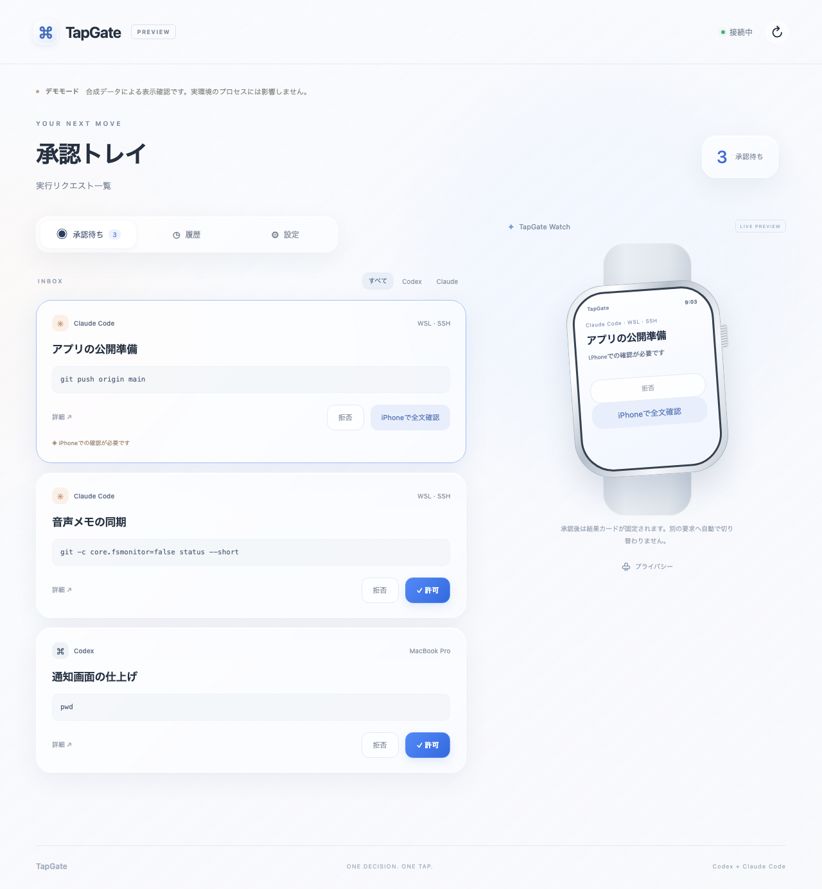

# TapGate



TapGateは、開発AIが要求するコマンド実行やファイル変更の承認を、Apple WatchおよびiPhoneから処理するための個人用承認システムです。

### 検証状況

Playwright（18/18）、Python（40/40）、iOS/watchOSビルド、Codex初期化（推論なし）成功。実機Push、Tailscale経路、実AI要求は未検証です。ブラウザテストは合成データであり、CoreSimulator不整合のためシミュレータ未起動です（`docs/verification.json`）。

## 目的

開発者が作業中に発生するAIの実行承認を、PCの前に拘束されずに手元のApple Watchから1タップで判断できる環境を整えます。

通常の承認操作は1タップで迅速に完結させます。一方で、コマンド内容が長い場合や詳細の確認が必要な操作については、iPhoneで全文を確認してから判断する二段階の設計をとります。

## 現状と対象範囲

本システムは、開発者本人が個人の作業環境で利用することを前提としています。

対応するAIクライアントは、公式のPermissionRequestフックを提供するClaude Code、および専用起動コマンドを介したCodexです。承認の通知および操作対象は、同一利用者のApple WatchとiPhoneに限られます。

既存の任意のCodex CLIプロセスやデスクトップアプリから発生する承認要求を外部から横取りする動作には対応していません。また、SSH接続元の端末側ではなく、実際にコマンドを実行する作業ホスト側にフックや起動コマンドを配置する必要があります。複数の作業ホストが存在する場合は、すべてのホストを同一のTapGateサーバーへ接続して運用します。

## 技術選定の理由

各構成要素の技術選定理由は以下の通りです。

| 構成要素                 | 選定技術                                       | 選定理由                                                                                                                                                                                    |
| :----------------------- | :--------------------------------------------- | :------------------------------------------------------------------------------------------------------------------------------------------------------------------------------------------ |
| 承認サーバー             | Python 3.11+ / SQLite                          | 外部ネットワークや重厚なミドルウェアへの依存を抑え、Mac、Linux、WSLで同一に動作させるため。                                                                                                 |
| プッシュ通知配信         | APNs直接通信 (`httpx[http2]`, `PyJWT[crypto]`) | 有料の外部通知SaaSを排除し、Apple公式APNsへ直接HTTP/2通信を行うため。認証秘密鍵や通知データを外部中継サービスに渡さずに済む。                                                               |
| クライアントアプリ       | SwiftUI / Liquid Glass (watchOS / iOS 26+)     | OS標準のUIコンポーネント、プッシュ通知、触覚フィードバック、アクセシビリティをネイティブに利用するため。                                                                                    |
| 端末間連携・資格情報     | Keychain / WatchConnectivity                   | 認証トークンを端末内の安全な領域に保持し、iPhoneからApple Watchへ設定を同期するため。また、直接通信ができない状況での通信経路としても機能する。                                             |
| 通信経路・ペアリング     | Tailscale Serve (HTTPS)                        | 公開証明書の管理やトークンの手動転記を省き、URLと短時間のワンタイムコードで安全なペアリングを確立するため。初期サーバーのバインド先をローカルループバックに保ち、第三者への無断露出を防ぐ。 |
| 検証用フロントエンド     | 素のHTML / CSS / JS                            | Node.js等のビルド工程を不要にし、Apple Watch画面の表示確認や承認操作を実ブラウザ上で手軽にテストするため。                                                                                  |
| 自動エンドツーエンド検証 | Playwright                                     | 実際に起動したサーバーに対して、ブラウザ経由の承認操作や画面挙動を自動検証するため。                                                                                                        |
| XcodeGen                 | XcodeGen                                       | `project.yml`からiPhone/Watchプロジェクトを再生成するため                                                                                                                                   |
| GitHub Actions           | GitHub Actions                                 | LinuxでPythonと実Chromiumテストを再実行するため                                                                                                                                             |
| MIT                      | MIT                                            | 個人改変や再配布を容易にするため                                                                                                                                                            |

### 通知と操作

タスク名とAI名を表示し、固定4コマンドのみ操作文字列を含めます。任意の引数や全文JSONはAPNsへ送りません。`TAPGATE_PRIVATE_NOTIFICATIONS=1`でタスク名非表示と通知許可無効化が可能です。先頭は非破壊な「内容を確認」（Double Tap対応）です。実機受信・操作は未検証です。

### Watch許可ポリシー

Watch直接許可は固定4コマンド（`pwd`、`/bin/pwd`、`git -c core.fsmonitor=false status --short`、`git -c core.fsmonitor=false --no-pager diff --stat --no-ext-diff --no-textconv`）に限定されます。`npm test`等の外部コードや未知操作、ファイル変更はiPhoneで全文確認後に許可します。

## クイックスタート

リポジトリを導入し、サーバーを起動します。

```bash
python3 -m pip install -e .
tapgate serve
```

別のターミナルを開き、ペアリングコマンドを実行します。

```bash
tapgate pair
```

UI表示確認用のデモサーバーを起動する場合は、以下のコマンドを実行します。デモ環境は合成データのみを扱い、実環境の承認処理からは完全に分離されています。

```bash
tapgate serve --demo --port 8788
```

## Tailscale Serveの設定例

Tailscaleを導入している環境では、以下のコマンドでローカルサーバーをTailnet内にHTTPSで公開できます。

```bash
tapgate serve --public-host YOUR-HOST.ts.net
# 別のターミナル
tailscale serve --bg 8787
```

この設定により、公衆インターネットにポートを開放することなく、Tailnet内の端末から安全にアクセスできます。

```bash
# Broker
tapgate host-pair
# SSH host
tapgate connect --url https://YOUR-HOST.ts.net --code 12345678
```

## AIクライアント連携

### Claude Code

Claude Codeの設定にTapGateの承認フックを追加するには、以下のコマンドを実行します。

```bash
tapgate claude-settings
TAPGATE_TASK="タスク名" claude
```

出力されたJSONスニペットを、対象ホストのClaude Code設定ファイル（`~/.claude/settings.json` など）にマージします。

これにより、`PermissionRequest` フック経由で承認要求がTapGateに転送されます。なお、ネットワーク制限などの返信不能な通知については `Notification` フックによって補完され、端末側で状況を確認できます。

### Codex

Codexは既存セッションの横取りに対応していないため、専用の起動コマンドを使用します。

```bash
tapgate codex --task "タスク名" "依頼内容"
```

このコマンドは公式のApp Server JSONLインターフェースを経由してCodexプロセスを起動し、発生した承認要求をTapGateへ転送します。

## Appleアプリの構築

watchOSおよびiOSクライアントのXcodeプロジェクトを生成して開きます。

```bash
cd apple
xcodegen generate
open TapGate.xcodeproj
```

プロジェクトを開いた後、Signing & Capabilities タブで自身の Apple Developer Team および Bundle Identifier に設定を変更します。

```bash
python3 -m pip install -e ".[push]"
```

## APNs環境変数の設定

サーバーからAPNsプッシュ通知を配信する場合、以下の環境変数を設定してサーバーを起動します。

- `TAPGATE_APNS_KEY_ID`: Apple Developerで発行したAPNs認証鍵のKey ID
- `TAPGATE_APNS_TEAM_ID`: Apple DeveloperのTeam ID
- `TAPGATE_APNS_KEY_PATH`: ダウンロードした認証秘密鍵（.p8ファイル）のローカルパス
- `TAPGATE_APNS_TOPIC`: アプリのBundle Identifier
- `TAPGATE_APNS_PRODUCTION`: 本番環境へ配信する場合は `1`、Sandbox環境の場合は `0` または未設定

## テストの実行

単体テストおよびPlaywrightを用いたブラウザテストを実行します。

```bash
python3 -m unittest discover -s tests -v
npm ci && npx playwright install chromium && npm test
```

## 制限事項

- **Codex既存プロセスの横取り非対応**: Codexの承認連携は専用起動コマンド（`tapgate codex`）経由の実行に限定されます。既存のCodex CLIセッションやデスクトップアプリから発生する承認要求を後から横取りすることはできません。
- **実行ホストへの設定配置**: SSH接続元の端末側ではなく、実際にコマンドを実行するホスト側でフックや起動コマンドを導入する必要があります。複数の作業ホストを利用する場合は、すべてのホストから同一のTapGateサーバーへ到達できるネットワーク構成が必要です。
- **プッシュ通知の配信挙動**: Appleの通知配信は、端末の装着状態、ロック状態、集中モードの設定に基づいて制御されます。そのため、iPhoneとApple Watchの両端末へ常に同時に通知が表示される保証はありません。
- **実機運用の前提条件**: watchOSおよびiOSの実機で通知を受信するには、Apple Developerアカウント、App ID、Push Notifications capability、APNs p8認証鍵、および実機への手動署名インストールが必要です。App Storeへの提出手順は本リポジトリの対象外です。
- **初期ネットワーク構成**: 初期状態のサーバーは `127.0.0.1` でのみ動作します。第三者向けの公開サーバーではないため、外部ネットワークから接続する場合はTailscale Serve等の暗号化経路を構築する必要があります。

### アカウントと実機検証

本公開はソース公開でありApp Store配布ではありません。開発者はApple Developer Program未登録/不明です。無料Personal Teamでの実機UI検証はPush権限除外と7日更新が必要（未実施）で、APNs実機Pushや配布には有料登録が必要です。
